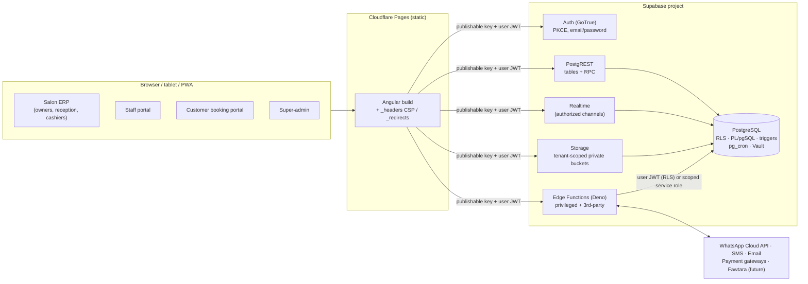

# 01 · System architecture

Salonzoft is a multi-tenant Salon & Spa ERP for Oman built as **Angular (static SPA) + Supabase (the entire backend)**. There is no custom API server.

## The four experiences

| Experience | Route root | Status | Notes |
|---|---|---|---|
| Salon ERP | `/` (app shell) | **Phase 1 shipped** (auth, onboarding, dashboard, settings) | Permission + entitlement driven navigation |
| Staff portal | `/` with `appointments.own` / `commissions.own` | Phase 2 | Same shell; staff without `dashboard.view` land on their first permitted page |
| Customer booking portal | `/book/{slug}` | Phase 5 | Public; uses dedicated anon-safe RPCs, rate limited |
| SaaS super-admin | `/admin` | Phase 6 | `platform_admins` table already exists; privileged Edge Function |

All four live in one Angular workspace with separate lazy routes, layouts and guards.

## Where business logic lives

| Layer | Used for | Examples |
|---|---|---|
| **Angular + supabase-js** | Authenticated reads, simple CRUD that RLS fully governs, uploads, realtime subscriptions, calling RPC / Edge Functions | Branch edit, role permission toggles, logo upload |
| **PostgreSQL RPC (PL/pgSQL)** | Anything multi-row, atomic, financial, or needing concurrency control. One RPC = one transaction | `create_tenant`, `create_invitation`, `accept_invitation`, `set_branch_working_hours`; later `create_appointment`, `finalize_invoice`, `redeem_package` |
| **Edge Functions** | Secrets, third-party APIs, webhooks (signature verification), service-role operations scoped to an already-authorized record | WhatsApp, payment gateways, subscription webhooks, Fawtara, PDF generation |
| **Triggers** | Invariants that must hold no matter which path writes: `updated_at`, audit trail, plan limits, single main branch | `app.audit_row`, `app.enforce_branch_limit` |

Rule: **never** compose a financial operation from several client-side writes. If two writes must succeed together, they belong in one RPC.

## Multi-tenant isolation model

* One Supabase project, one database, **shared schema**, strict isolation by `tenant_id UUID NOT NULL` on every business table (enforced by an automated test).
* Child tables reference parents with **composite foreign keys** `(parent_id, tenant_id) → parent(id, tenant_id)`, so the database rejects a row in tenant A that points at a parent in tenant B, even if RLS were misconfigured.
* Identity = Supabase Auth user. Authorization = rows in `tenant_memberships`, `user_roles`, `role_permissions`, `user_branch_access`, `module_entitlements`, `tenant_subscriptions`. **JWT user_metadata is never used for authorization.**
* A user may belong to many tenants. The "active tenant" is a UI preference (localStorage), re-validated on load; the server never trusts it. Every query is filtered by RLS, so sending another tenant's id just returns nothing.
* `tenant_id` is never updatable from the client (column-level grants), so a row can't be moved between tenants.

See [03-security-and-permissions.md](03-security-and-permissions.md) for the policy design.

## Branch model

* `branches` belong to a tenant. A membership is either `all_branches` (owners always) or has explicit `user_branch_access` rows.
* Branch-scoped business tables (appointments, invoices, stock, cash sessions…) will use `branch_id IN (SELECT app.branch_ids_with_permission('x.view'))`, so a permission and branch access are both required.

## Subscriptions and entitlements

`tenant_subscriptions` (plan + status + trial) and `module_entitlements` (module on/off per tenant) are read-only for clients. `app.permissions_for()` returns no permission for a module the plan doesn't include. If the tenant is not operational (expired trial, suspended), staff lose every permission and the owner keeps only `billing.manage`, `settings.view`, `dashboard.view` and `team.view`. Plan limits (branches, staff seats) are enforced in triggers and RPCs under a tenant-row lock.

## Realtime (from Phase 2)

* Use **Broadcast/Postgres-Changes on authorized private channels**, named `tenant:{tenant_id}:branch:{branch_id}:appointments`. Channel authorization is done with RLS on `realtime.messages` using the same `app.*` helpers.
* Payloads carry ids and status only, never customer PII. Clients refetch affected rows through RLS.
* Subscriptions are created per screen and removed in `DestroyRef.onDestroy`.

## Storage

* One private bucket `tenant-assets` (5 MB, PNG/JPEG/WebP; SVG excluded because it can carry scripts).
* Path convention `tenants/{tenant_id}/…` or `tenants/{tenant_id}/branches/{branch_id}/…`; policies parse the path and reject anything malformed (including `..`).
* Downloads via short-lived signed URLs. Future buckets: `tenant-documents` (invoices/exports, never public).
* Storage objects are **not** part of Postgres backups (see deployment doc).

## Money, time and locale

* Money is `NUMERIC(12,3)` in Postgres and BigInt minor units (baisa) in the client. JavaScript floats are never used for totals. Server-side functions are authoritative.
* Timestamps are `timestamptz` (UTC). They're rendered in branch → tenant timezone (default `Asia/Muscat`), with optional Hijri (Umm al-Qura) display.
* English/Arabic at runtime with full RTL (logical CSS properties). Bilingual DB fields use the `*_en` / `*_ar` pairs.
