# 02 · Database design and ERD

**Conventions (every table):** UUID PK (`gen_random_uuid()`); `tenant_id uuid NOT NULL` on business tables; `branch_id` where branch-scoped; `created_at` / `updated_at` (trigger `app.set_updated_at`); composite FKs `(x_id, tenant_id)` for same-tenant integrity; CHECK constraints for formats and enums; indexes on every FK and on `(tenant_id, …)` access paths; RLS enabled; explicit, column-scoped grants. Money is `numeric(12,3)`, rates `numeric(5,2)`.

Schemas: `public` (exposed: tables + RPCs), `app` (private helpers, not exposed by the API), `auth` / `storage` (Supabase-managed).

## Phase 1: implemented (migrations 0001–0007)

Phase 2 part 1 (migrations 0008–0009: services, staff, customers) is listed under [Migration list](#migration-list).

```mermaid
erDiagram
  auth_users ||--|| profiles : "1:1"
  auth_users ||--o{ tenant_memberships : "belongs to"
  auth_users ||--o| platform_admins : "may be"

  tenants ||--|| tenant_settings : has
  tenants ||--o{ tenant_subscriptions : has
  subscription_plans ||--o{ tenant_subscriptions : "plan of"
  subscription_plans ||--o{ plan_modules : includes
  modules ||--o{ plan_modules : ""
  tenants ||--o{ module_entitlements : entitled
  modules ||--o{ module_entitlements : ""
  modules ||--o{ permissions : groups
  tenants ||--o{ tenant_usage : meters

  tenants ||--o{ roles : defines
  role_templates ||--o{ roles : "copied into"
  role_templates ||--o{ role_template_permissions : ""
  roles ||--o{ role_permissions : grants
  permissions ||--o{ role_permissions : ""

  tenants ||--o{ tenant_memberships : has
  tenant_memberships ||--o{ user_roles : holds
  roles ||--o{ user_roles : ""
  tenants ||--o{ branches : operates
  branches ||--o{ branch_working_hours : opens
  tenant_memberships ||--o{ user_branch_access : "may access"
  branches ||--o{ user_branch_access : ""
  tenants ||--o{ tenant_invitations : issues
  tenants ||--o{ audit_logs : records

  tenants {
    uuid id PK
    text slug UK "booking URL"
    text name
    text name_ar
    text business_type
    text status "active|suspended|closed"
  }
  tenant_settings {
    uuid tenant_id PK
    char currency_code "OMR"
    smallint currency_decimals "3"
    text timezone "Asia/Muscat"
    smallint_arr weekend_days "{5,6}"
    bool vat_registered
    text vat_number
    numeric default_vat_rate "5.00"
    bool prices_include_vat
  }
  tenant_memberships {
    uuid id PK
    uuid tenant_id FK
    uuid user_id FK
    text status
    bool is_owner "one per tenant"
    bool all_branches
  }
  branches {
    uuid id PK
    uuid tenant_id FK
    text code UK
    text name_en
    text name_ar
    bool is_main "one per tenant"
  }
  tenant_invitations {
    uuid id PK
    text email
    text token_hash "SHA-256 only"
    uuid_arr role_ids
    uuid_arr branch_ids
    timestamptz expires_at
  }
```

## Target model (Phases 2–6)

These tables are designed but **not yet implemented**. Each arrives in its phase's migration together with RLS, RPCs and tests.

```mermaid
erDiagram
  branches ||--o{ employees : employs
  employees ||--o{ employee_services : "skilled in"
  employees ||--o{ staff_shifts : works
  employees ||--o{ staff_leaves : takes
  service_categories ||--o{ services : groups
  services ||--o{ service_prices : "priced per branch"
  services ||--o{ product_consumption_rules : consumes
  resources ||--o{ appointment_resources : "booked as"

  customers ||--o{ appointments : books
  appointments ||--o{ appointment_services : contains
  appointment_services ||--o{ appointment_staff : "performed by"
  appointments ||--o{ appointment_resources : uses
  customers ||--o{ customer_consents : grants
  customers ||--o{ customer_notes : has

  cash_sessions ||--o{ payments : collects
  invoices ||--o{ invoice_items : lines
  invoices ||--o{ payments : "settled by"
  invoices ||--o{ credit_notes : "corrected by"
  invoices ||--o{ refunds : refunds
  invoice_items ||--o{ commission_entries : earns

  packages ||--o{ customer_packages : sold
  customer_packages ||--o{ package_redemptions : redeemed
  memberships ||--o{ customer_memberships : sold
  gift_vouchers ||--o{ payments : "used in"
  customers ||--o{ loyalty_transactions : earns

  products ||--o{ inventory_movements : moves
  inventory_movements }o--|| inventory_balances : "rolls up"
  suppliers ||--o{ purchases : supplies
  purchases ||--o{ purchase_items : lines

  notification_templates ||--o{ notification_jobs : renders
  notification_jobs ||--o{ notification_attempts : tries
  campaigns ||--o{ campaign_recipients : targets

  expense_categories ||--o{ expenses : classifies
  expenses ||--o{ financial_transactions : posts
  invoices ||--o{ financial_transactions : posts
```

### Key design decisions for upcoming modules

| Concern | Design |
|---|---|
| **Double-booking** | `appointment_staff(staff_id, during tstzrange)` and `appointment_resources(resource_id, during)` with `EXCLUDE USING gist (tenant_id WITH =, staff_id WITH =, during WITH &&) WHERE (status not in cancelled/no_show)` (btree_gist). `create_appointment` additionally locks the staff row, validates shifts/leave/branch hours/buffers, and maps exclusion violations to `SLOT_UNAVAILABLE`. |
| **Invoice posting** | Draft invoices are mutable; `finalize_invoice(p_invoice_id, p_idempotency_key)` locks the invoice, recomputes totals server-side from price/tax snapshots, allocates a gap-free number from a per-tenant/branch `invoice_sequences` row (`SELECT … FOR UPDATE`), posts stock movements, commission entries and ledger lines, then marks it `posted`. Posted invoices are immutable (trigger); corrections are credit notes. |
| **Idempotency** | `idempotency_keys(tenant_id, scope, key, request_hash, response jsonb)` with a unique key. Every money RPC and payment webhook checks it before doing work and returns the stored response on replay. |
| **Package redemption** | `customer_packages.remaining_sessions` is decremented with `UPDATE … WHERE remaining_sessions >= p_qty RETURNING`. A zero-row update means `INSUFFICIENT_BALANCE`, so concurrent redemptions can't overdraw. Prepaid liability is tracked separately from recognised revenue. |
| **Inventory** | Append-only `inventory_movements` ledger (signed qty, unit cost, batch, reason, source document). `inventory_balances` is maintained in the same transaction with a row lock, and a CHECK keeps it from going negative unless the branch allows it. Valuation: weighted average per branch. |
| **VAT** | Rate snapshot on every invoice line (`vat_rate`, `vat_category` standard/zero/exempt, `price_includes_vat`) plus line-level rounding to 3 dp. Oman's standard rate defaults to 5% and must be verified with the Tax Authority. |
| **E-invoicing** | `e_invoice_submissions(invoice_id, provider, status, payload_hash, response)` is filled by the `e-invoice-submit` Edge Function. A PDF on its own is not treated as compliance. |
| **Reporting** | Parameterised `SECURITY INVOKER` report functions over indexed tables. Nightly `daily_branch_summaries` (pg_cron) serve dashboards and are rebuilt idempotently. |

## Migration list

| File | Contents |
|---|---|
| `20261109000001_foundation.sql` | Default-privilege hardening, `app` schema, error helpers, catalogues (modules, permissions, plans, role templates), profiles + `handle_new_user` |
| `20261109000002_tenancy.sql` | tenants, settings, subscriptions, entitlements, usage, roles, memberships, branches, hours, branch access, invitations, audit_logs |
| `20261109000003_authorization.sql` | `app.*` authorization helpers, audit helpers |
| `20261109000004_rls_and_grants.sql` | RLS on every table, explicit grants, all policies |
| `20261109000005_triggers.sql` | Audit triggers, immutable audit log, plan limits, single main branch, seat capacity |
| `20261109000006_rpc_tenancy.sql` | Phase 1 RPCs |
| `20261109000007_storage.sql` | `tenant-assets` bucket + path-based policies |
| `20261109000008_services_staff.sql` | Service catalogue, branch prices, resources, employees, branch/skill assignments, weekly shifts (overlap trigger), leave, special periods (holidays / Ramadan hours), employee plan limit, 4 RPCs |
| `20261109000009_customers.sql` | `pg_trgm`, E.164 mobile normalisation, customers (unique mobile per tenant, trigram search), append-only consents, sensitive-aware notes, search / duplicate / import RPCs |
| `20261109000010_appointments.sql` | `btree_gist`; `appointments` + `appointment_services` (price/name snapshots, blocked ranges incl. buffers) with **exclusion constraints** per employee and per resource; multirange schedule helpers (branch hours ∩ shifts − leave − bookings, branch timezone); booking, reschedule, status, calendar, availability and stats RPCs; realtime publication |
| `20261109000011_pos_invoicing.sql` | `cash_sessions` (one open per branch), `invoice_sequences` (internal, gap-free), `invoices` (draft → posted, credit notes linked to the original, seller / customer / VAT snapshots), `invoice_items` (per-line VAT, list vs charged price), `payments` (in / out, cash tied to a session); immutability triggers; read-only RLS; POS RPCs |
| `20261109000012_packages_vouchers.sql` | `packages` + `package_items`, `memberships`, `customer_packages` + `customer_package_balances` (guarded decrement) + `package_redemptions`, `customer_memberships`, `gift_vouchers` (gift / store credit / deposit, `XXXX-XXXX-XXXX` codes) + `voucher_transactions`; invoice line kinds package / membership / voucher and package redemption; payment method `voucher`; POS RPCs redefined; wallet RPCs |
| `20261109000013_inventory_purchasing.sql` | `products`, `service_product_usage`, `suppliers`, `inventory_balances` (qty + weighted average cost per branch), append-only `inventory_movements` (single writer `app.stock_move`, row-locked), `purchase_orders` / `purchase_order_items` / `purchase_receipts`; POS line kind `product`; stock posted by an invoice trigger at posting; `allow_negative_stock` setting |

### Phase 2 part 1 notes

* `staff_shifts` references `employee_branches (employee_id, branch_id)`, so a shift can only exist where the employee works, and removing the assignment removes its shifts.
* Overlaps that a CHECK can't express (shifts of one employee, special periods of one branch) are enforced by row-locking triggers, so direct table writes and RPCs follow the same rules.
* `employees.membership_id` uses `ON DELETE SET NULL (membership_id)` (PG15+), so removing a login keeps the employee and its history.
* `customers.search_text` is a stored generated column with a GIN trigram index. Phone searches use the digits only.
